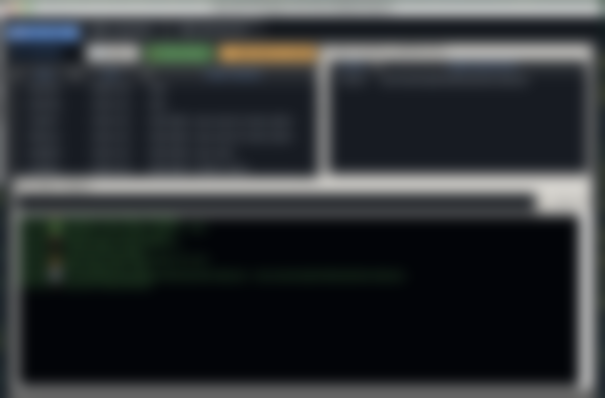

# Smart Git-FTP Deployer

[](https://opensource.org/licenses/MIT)

Aplikasi desktop (Python/Tkinter) untuk deployment berbasis Git ke server hosting yang hanya menyediakan akses FTP. Aplikasi membaca riwayat *commit* repositori lokal, menghitung daftar berkas yang berubah antar *commit*, lalu mengunggah atau menghapus berkas tersebut di server melalui FTP/FTPS.

Cocok digunakan pada *shared hosting* (cPanel/DirectAdmin) yang tidak menyediakan akses SSH, sehingga pipeline deployment berbasis Git dapat tetap berjalan.

**Versi 2.2**



## Fitur

- **Deployment berbasis commit** — pilih satu commit atau rentang commit; aplikasi menghitung berkas yang ditambahkan, diubah, dan dihapus dari *diff* Git.
- **Dua mode eksekusi** — bertahap (setiap commit diproses berurutan) atau akumulatif (satu batch untuk rentang commit). Opsi berhenti otomatis saat terjadi galat (*fail-fast*) dan pembatalan di tengah proses.
- **FTP dan FTPS** — opsi FTP over TLS untuk enkripsi kanal kontrol dan data.
- **Multi profil** — sejumlah konfigurasi server dapat disimpan dalam satu berkas dan diganti secara langsung.
- **Peramban berkas** — menjelajahi struktur direktori lokal dan server pada antarmuka yang sama.
- **Pemetaan jalur (path mapping)** — memetakan folder lokal ke folder remote yang berbeda, contohnya `dist/` ke `public_html/app/`.
- **Ekspor riwayat commit** — menyusun daftar commit menjadi pernyataan SQL yang dapat disimpan sebagai berkas atau disalin ke *clipboard*.
- **Konsol eksekusi** — log berwarna dengan progres per berkas dan stempel waktu.

## Persyaratan

- Python 3.8 atau lebih baru (pastikan paket **Tkinter** tersedia; pada beberapa distribusi terpisah sebagai `python3-tk`).
- Git yang dapat dijalankan dari baris perintah.

## Instalasi dan Penggunaan

1. Kloning repositori ini.

   ```bash
   git clone https://github.com/ridzidev/smart-git-ftp-deployer.git
   cd smart-git-ftp-deployer
   ```

2. Jalankan aplikasi dari direktori repositori Anda sendiri (folder yang berisi `.git`).

   ```bash
   python smart_deploy.py
   ```

3. Buka tab **Konfigurasi**, isi Host, User, dan Password FTP, direktori lokal, dan direktori remote. Aktifkan opsi **FTP over TLS (FTPS)** jika server mendukungnya, lalu simpan.

4. Buka tab **Deployment Engine**, pilih commit atau rentang commit, tinjau daftar berkas yang akan diproses, kemudian mulai deployment.

## Konfigurasi (deploy_config.json)

Konfigurasi disimpan dalam berkas `deploy_config.json` di lokasi yang sama dengan skrip. Aplikasi mengatur izin berkas ini menjadi `0600` setiap kali menyimpan.

| Kunci | Keterangan |
|---|---|
| `FTP_HOST` | Host server FTP, contoh `ftp.domainanda.com` |
| `FTP_USER` | Username FTP |
| `FTP_PASS` | Password FTP |
| `FTP_TLS` | `true` untuk memakai FTPS (kanal kontrol dan data terenkripsi) |
| `LOCAL_DIR` | Direktori proyek lokal yang berisi `.git` |
| `REMOTE_DIR` | Direktori tujuan di server, contoh `/public_html` |
| `EXCLUDE_PATTERNS` | Daftar pola berkas yang tidak ikut diunggah |
| `PATH_MAPPINGS` | Daftar pemetaan folder lokal ke folder remote |
| `active_profile` | Nama profil aktif |

Nilai bawaan `EXCLUDE_PATTERNS`:

```json
["*.git*", ".env", "node_modules", "vendor", ".idea", ".vscode", ".DS_Store", "deploy_config.json"]
```

Contoh `PATH_MAPPINGS`:

```json
[
  { "local": "dist/", "remote": "public_html/app/" }
]
```

## Catatan Keamanan

- Password FTP disimpan sebagai teks biasa dalam berkas konfigurasi. Aplikasi memitigasi hal ini dengan izin berkas `0600` dan pengecualian `deploy_config.json` pada daftar unggahan. Jangan pernah menambahkan berkas ini ke Git ataupun membagikannya.
- Gunakan opsi FTPS bila server mendukungnya. FTP polos mengirim kredensial tanpa enkripsi, sehingga dapat dibaca pihak yang memantau jaringan.
- Deployment hanya memproses berkas yang tercatat pada riwayat Git, sehingga berkas lokal seperti `.env` atau `.git` tidak pernah terunggah selama pola pengecualian belum diubah.

## Struktur Antarmuka

| Tab | Fungsi |
|---|---|
| Deployment Engine | Pemilihan commit, tinjauan antrean berkas, eksekusi, dan log |
| Ekspor SQL | Menyusun riwayat commit menjadi pernyataan SQL |
| Peramban Berkas | Menjelajahi direktori lokal dan server |
| Konfigurasi | Pengelolaan profil, parameter server, dan pemetaan jalur |

## Kontribusi

Kontribusi berupa laporan galat, usulan fitur, atau *pull request* diterima dengan terbuka. Untuk perubahan besar, buka *issue* terlebih dahulu agar dapat didiskusikan sebelum diterapkan.

## Changelog

### v2.2 — 2026-10-21

- Dukungan FTP over TLS (FTPS). Pengembang dapat mengaktifkan `FTP_TLS` untuk mengenkripsi kanal kontrol dan data pada Deployment Engine maupun peramban server.
- Berkas `deploy_config.json` otomatis diatur izin `0600` setiap kali aplikasi menyimpannya.
- Nomor versi ditampilkan pada judul jendela dan log awal aplikasi.
- `.gitignore` dirapikan: `smart_deploy.py` tidak lagi diabaikan (berkas memang didistribusikan), ditambah `.env` dan `__pycache__/`.
- Riwayat repositori dibersihkan dari berkas konfigurasi yang memuat kredensial; screenshot diganti dengan versi yang disamarkan.
- Dokumentasi ditulis ulang; berkas `LICENSE` ditambahkan.

### v2.1.x — April dan Agustus 2026

- Hasil ekspor SQL dapat disalin langsung ke *clipboard*.
- Perbaikan pengelolaan profil: penambahan, penggantian, dan penghapusan profil menjadi lebih andal.

### v2.1 — 2026-01-05

- Pemilihan komit terbaru secara otomatis dan pemilihan rentang commit.
- Mode bertahap per komit dan mode akumulatif; pilihan berhenti otomatis saat galat.
- Tombol pembatalan deployment di tengah proses.
- Tab ekspor riwayat commit ke SQL.
- Muat ulang riwayat otomatis saat jendela kembali mendapat fokus, ditambah pintasan F5.

### v2.0 — 2026-01-05

- Antarmuka dibangun ulang dengan tema gelap dan konsol log berwarna.
- Peramban berkas lokal dan server berbasis struktur pohon.
- Pemetaan jalur (path mapping) antara folder lokal dan folder remote.
- Peningkatan pengelolaan konfigurasi multi profil.

### v1.0 — 2025-10-18

- Rilis awal: deployment berbasis *diff* Git melalui FTP dengan berkas konfigurasi JSON.

## Lisensi

Didistribusikan di bawah Lisensi MIT — lihat berkas `LICENSE`.

Dibuat oleh [ridzidev](https://github.com/ridzidev).
