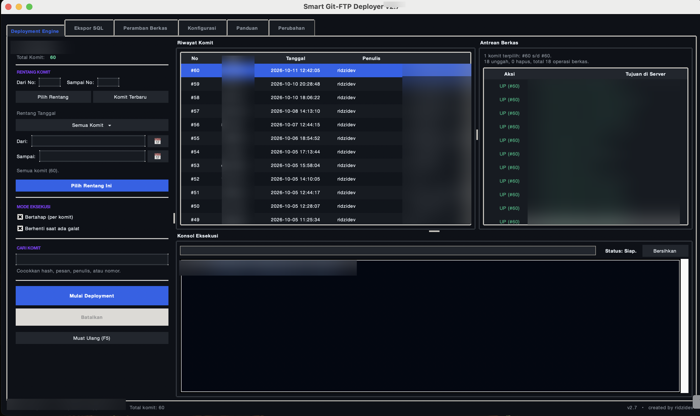
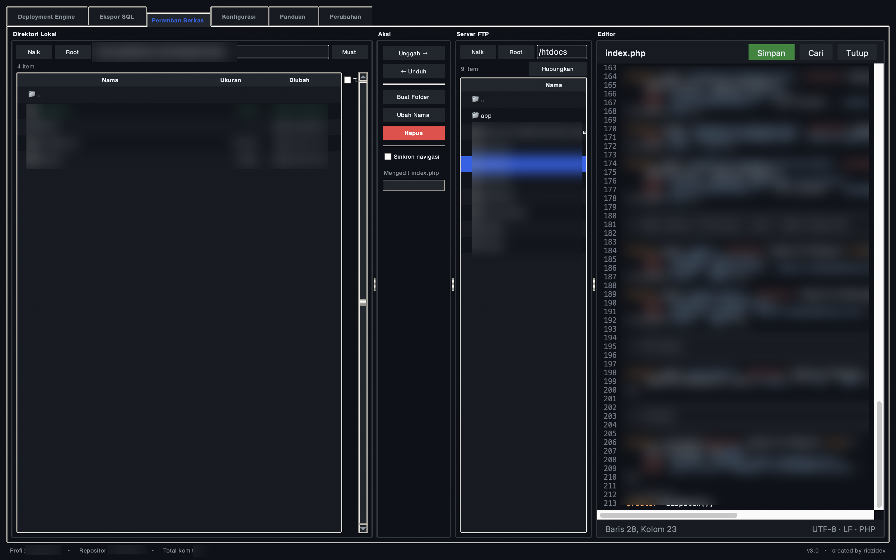

# Smart Git-FTP Deployer

[](https://opensource.org/licenses/MIT)

Aplikasi desktop berbasis Python dan Tkinter untuk melakukan deploy proyek Git ke server yang hanya menyediakan akses FTP. Aplikasi membaca riwayat commit pada repositori lokal, menghitung berkas yang berubah antar commit, lalu mengunggah atau menghapus berkas tersebut di server.

Aplikasi ini cocok dipakai di shared hosting (cPanel atau DirectAdmin) yang tidak menyediakan akses SSH. Dengan begitu, alur deploy berbasis commit tetap bisa berjalan seperti biasa.

Versi 3.0




## What's New di Versi 3.0

Pembaruan Versi 3.0 menghadirkan fleksibilitas penuh untuk alur kerja deployment dan manajemen berkas langsung di dalam satu aplikasi:

* **Text Editor Terintegrasi:** Modul editor kode bawaan untuk mengedit file langsung di server secara instan tanpa perlu membuka aplikasi editor eksternal, lengkap dengan nomor baris, status bar encoding (UTF-8/LF), dan tombol simpan langsung ke FTP.
* **Deployment Berbasis Git:** Sinkronisasi cerdas yang hanya mengunggah berkas yang berubah berdasarkan hash komit atau rentang komit tertentu dari repositori lokal.
* **File Manager FTP Tradisional :** Peramban berkas dua panel (Lokal & Remote) yang mendukung operasi transfer manual seperti unduh, unggah, buat direktori, ubah nama, dan hapus berkas secara langsung.

---

## Fitur

- Deployment berbasis commit. Pilih satu commit atau rentang commit, lalu aplikasi menghitung berkas yang ditambahkan, diubah, dan dihapus dari diff Git.
- Saring rentang tanggal. Menu preset cepat seperti 7 hari terakhir, bulan lalu, atau tahun lalu, lengkap dengan pemilih tanggal kalender. Hitungan hasil saringan tampil langsung, tersedia di tab Deployment Engine dan Ekspor SQL.
- Dua mode eksekusi, yaitu bertahap (satu commit diproses satu per satu) dan akumulatif (satu batch untuk satu rentang). Ada opsi berhenti saat galat dan tombol batalkan di tengah proses.
- FTP dan FTPS. Aktifkan opsi FTP over TLS untuk mengenkripsi kanal kontrol dan data.
- Multi profil. Sejumlah konfigurasi server bisa disimpan dalam satu berkas dan dipilih sesuai kebutuhan.
- Konfigurasi terenkripsi. Berkas konfigurasi disimpan terenkripsi AES-256-GCM sehingga password FTP tidak berjajar sebagai teks biasa.
- Peramban berkas. Menjelajahi struktur direktori lokal dan server dalam satu tampilan.
- **Editor teks bawaan.** Berkas remote bisa dibuka dan disunting langsung di samping peramban berkas, lengkap dengan nomor baris, sorot sintaks, cari dan ganti, lalu disimpan kembali ke server dengan Ctrl/Cmd+S.
- Pemetaan jalur. Folder lokal bisa dipetakan ke folder remote yang berbeda, misalnya dist/ ke public_html/app/.
- Ekspor riwayat commit ke bentuk query SQL yang bisa disimpan sebagai berkas atau disalin ke clipboard.
- Tampilan dan kenyamanan: layar pembuka, tab Panduan berisi tutorial interaktif, tab Perubahan untuk riwayat versi, bilah status ringkas, dan jenis huruf yang menyesuaikan sistem operasi.
- Konsol eksekusi berwarna dengan progres per berkas dan stempel waktu.

## Persyaratan

- Python 3.8 atau lebih baru. Pastikan paket Tkinter tersedia; pada sebagian distro Linux terpasang terpisah bernama python3-tk.
- Git yang bisa dijalankan dari baris perintah.
- Paket `cryptography` untuk membuka dan menyimpan berkas konfigurasi terenkripsi.

## Instalasi dan Penggunaan

1. Kloning repositori ini.

   ```bash
   git clone https://github.com/ridzidev/smart-git-ftp-deployer.git
   cd smart-git-ftp-deployer
   ```

2. Pasang dependensi.

   ```bash
   python3 -m pip install --user cryptography
   ```

3. Jalankan aplikasi dari folder repositori ini.

   ```bash
   python3 app.py
   ```

   Berkas `smart_deploy.py` masih tersedia sebagai pemanggil kompatibilitas, sama saja dengan `python3 smart_deploy.py`.

4. Buka tab Konfigurasi, isi Host, User, dan Password FTP, direktori lokal, dan direktori remote. Aktifkan opsi FTP over TLS bila server mendukungnya, lalu tekan Simpan Konfigurasi Profil. Saat pertama kali disimpan, berkas konfigurasi otomatis berubah menjadi brankas terenkripsi dan berkas kunci dibuat di komputer Anda.

5. Buka tab Deployment Engine, pilih commit atau rentang commit, tinjau daftar berkas yang akan diproses, kemudian mulai deployment.

## Berkas Konfigurasi (deploy_config.json)

Aplikasi membaca `deploy_config.json` di folder yang sama dengan `app.py`. Isi berkas bercorak seperti berikut, berupa satu segmen sandi:

```json
{
  "app": "smart-git-ftp-deployer",
  "format": "AESGCM-256/v1",
  "vault": "gAAAA..."
}
```

Isi di dalam brankas berupa kumpulan profil. Setiap profil menyimpan kolom berikut:

| Kunci | Keterangan |
|---|---|
| `FTP_HOST` | Host server FTP, contoh `ftp.domainanda.com` |
| `FTP_USER` | Username FTP |
| `FTP_PASS` | Password FTP |
| `FTP_TLS` | `true` untuk memakai FTPS (kanal kontrol dan data terenkripsi) |
| `LOCAL_DIR` | Direktori proyek lokal yang berisi `.git` |
| `REMOTE_DIR` | Direktori tujuan di server, contoh `/public_html` |
| `EXCLUDE_PATTERNS` | Daftar pola berkas yang tidak ikut diunggah |
| `PATH_MAPPINGS` | Daftar pemetaan folder lokal ke folder remote |

Nilai bawaan `EXCLUDE_PATTERNS`:

```json
["*.git*", ".env", "node_modules", "vendor", ".idea", ".vscode", ".DS_Store", "deploy_config.json"]
```

Contoh `PATH_MAPPINGS`:

```json
[
  { "local": "dist/", "remote": "public_html/app/" }
]
```

Berkas konfigurasi versi lama yang masih berupa teks biasa tetap bisa dibuka. Bentuknya berubah menjadi brankas terenkripsi otomatis setelah pertama kali tekan Simpan Konfigurasi Profil.

## Kunci Brankas

Enkripsi memakai AES-256-GCM dengan kunci 32 byte acak yang tidak pernah ditulis di dalam berkas konfigurasi. Kunci dicari dengan urutan berikut:

1. Variabel lingkungan `SMART_DEPLOY_KEY`, berisi kunci dalam bentuk base64. Cocok untuk pengguna tingkat lanjut atau lintas mesin.
2. Berkas `~/.smart_git_ftp_deployer.key`. Berkas ini dibuat otomatis dengan izin `0600` saat pertama kali dibutuhkan.

Simpan cadangan berkas kunci di tempat aman, misalnya lokasi yang terikut cadangan Time Machine. Apabila kunci hilang atau tidak cocok, isi brankas tidak dapat dibuka dan aplikasi menolak menyimpan konfigurasi supaya data lama tidak tertimpa konfigurasi kosong. Untuk memindahkan konfigurasi ke mesin lain, cukup salin `deploy_config.json` bersama berkas kuncinya.

## Catatan Keamanan

- Konfigurasi tersimpan terenkripsi sejak versi 2.5. Password, host, dan username tidak berjajar sebagai teks biasa di dalam `deploy_config.json`.
- Setiap penyimpanan memakai garam acak baru, jadi hasil sandi tidak sama meskipun kontennya tidak berubah.
- Berkas `deploy_config.json` telah dikecualikan di `.gitignore`. Jangan pernah membagikan berkas ini bersama berkas kuncinya kepada orang lain secara bersamaan.
- Gunakan opsi FTPS bila server mendukungnya. FTP polos mengirim kredensial tanpa enkripsi sehingga bisa dibaca pihak yang memantau jaringan.
- Deployment hanya memproses berkas yang tercatat pada riwayat Git, sehingga berkas lokal seperti `.env` atau `.git` tidak pernah terunggah selama pola pengecualian belum diubah.

## Struktur Berkas

Kode aplikasi dikumpulkan per pekerjaan dalam paket `smart_deploy_app/`:

| Berkas | Isi |
|---|---|
| `app.py` | Titik masuk aplikasi |
| `smart_deploy.py` | Pemanggil kompatibilitas (menyalurkan pada `app.py`) |
| `smart_deploy_app/config.py` | Konfigurasi bawaan, penyimpanan profil, utilitas jalur |
| `smart_deploy_app/secure_store.py` | Brankas enkripsi AES-256-GCM dan pengelolaan kunci |
| `smart_deploy_app/theme.py` | Palet warna antarmuka |
| `smart_deploy_app/git_manager.py` | Pembaca riwayat dan diff Git |
| `smart_deploy_app/ftp_deployer.py` | Transport FTP/FTPS |
| `smart_deploy_app/ui_date_filter.py` | Widget saring rentang tanggal dan kalender pilih tanggal |
| `smart_deploy_app/ui_dropdown.py` | Widget dropdown pilihan buatan sendiri (pengganti popdown ttk.Combobox) |
| `smart_deploy_app/ui_deploy.py` | Tab Deployment Engine |
| `smart_deploy_app/ui_exporter.py` | Tab Ekspor SQL |
| `smart_deploy_app/ui_browser.py` | Tab Peramban Berkas |
| `smart_deploy_app/ui_editor.py`      | Editor teks bawaan: nomor baris, sorot sintaks, cari dan ganti          |
| `smart_deploy_app/ui_config.py` | Tab Konfigurasi |
| `smart_deploy_app/ui_tutorial.py` | Tab Panduan berisi tutorial interaktif |
| `smart_deploy_app/ui_changelog.py` | Tab Perubahan berisi riwayat versi |
| `smart_deploy_app/ui_splash.py` | Layar pembuka aplikasi |
| `smart_deploy_app/ui_app.py` | Jendela utama (perakitan seluruh tab) |

## Struktur Antarmuka

| Tab | Fungsi |
|---|---|
| Deployment Engine | Pemilihan commit, saring tanggal, tinjauan antrean berkas, eksekusi, dan log |
| Ekspor SQL | Menyusun riwayat commit menjadi pernyataan SQL |
| Peramban Berkas | Menjelajah, mengunggah, mengunduh, dan mengedit berkas remote lewat editor bawaan |
| Konfigurasi | Pengelolaan profil, parameter server, dan pemetaan jalur |

## Kontribusi

Kontribusi berupa laporan galat, usulan fitur, atau pull request diterima dengan terbuka. Untuk perubahan besar, buka issue terlebih dahulu agar bisa didiskusikan sebelum diterapkan.

## Changelog

### v3.0 (25 Oktober 2026)

- Editor teks bawaan di tab Peramban Berkas: memilih berkas remote membuka editor di samping daftar berkas.
- Editor dibuat sendiri dengan Tkinter tanpa dependensi baru: nomor baris, sorot sintaks (Python, PHP, JavaScript, HTML, CSS, JSON, SQL, shell, konfigurasi), cari dan ganti, indentasi otomatis, Tab dan Shift+Tab untuk blok, serta undo dan redo.
- Simpan dengan Ctrl/Cmd+S langsung mengunggah ke server. Penanda belum tersimpan tampil di bilah editor dan ada konfirmasi sebelum perubahan dibuang.
- Sandi berkas dan akhir baris dipertahankan (UTF-8 dengan atau tanpa BOM, LF atau CRLF). Berkas biner dan berkas di atas 2 MB tidak dibuka di editor.

### v2.7 (21 Oktober 2026)

- Tab Peramban Berkas dibangun ulang menyerupai pengelola berkas FTP: daftar datar berkolom Nama, Ukuran, dan Diubah, ikon folder dan berkas, bilah alamat per panel, tombol Naik, Root, dan Muat, baris `..` untuk naik folder, serta sortir dengan klik kepala kolom.
- Operasi berkas kini bisa dijalankan langsung dari peramban: Unggah dan Unduh untuk banyak pilihan sekaligus (folder diambil seluruh isinya), Buat Folder, Ubah Nama, dan Hapus berlapis. Tersedia menu klik kanan, dobel klik untuk pindah folder atau transfer, bar progres, serta konfirmasi sebelum hapus dan timpa.
- Panel lokal menampilkan status Git berwarna: hijau untuk berkas baru, kuning untuk yang berubah, dan coret merah untuk yang masuk daftar pengecualian deploy.
- Saklar sinkron navigasi membuka folder padanan di server saat panel lokal berpindah folder, dan opsi tampilkan berkas tersembunyi berlaku untuk kedua panel.
- Deployment Engine dan Ekspor SQL diperapai: aksen warna pada tajuk dan status, baris antrean diwarnai menurut aksi, serta pratinjau SQL tersorot sintaks.

### v2.6 (21 Oktober 2026)

- Layar pembuka menampilkan identitas aplikasi lalu memudar keluar setelah data awal siap.
- Tab Panduan dengan tutorial interaktif: topik di kiri, langkah penggunaan di kanan, termasuk jalan pintas membuka tab Konfigurasi.
- Tab Perubahan menampilkan riwayat versi lengkap sejak v1.0 beserta tautan halaman proyek.
- Tab Deployment Engine dan Ekspor SQL disusun ulang: seluruh kendali dipindah ke satu sidebar di kiri, daftar komit menempati area utama, dan area hasil melebar di bawahnya.
- Jenis huruf menyesuaikan sistem operasi, kolom isian gelap, baris tabel bertukar warna, tekanan tombol lebih halus, scrollbar gelap, dan bilah status profil serta repositori di bawah jendela.

### v2.5 (21 Oktober 2026)

- `deploy_config.json` kini disimpan sebagai brankas terenkripsi AES-256-GCM. Password FTP tidak lagi ditulis sebagai teks biasa. Kunci brankas berada di `~/.smart_git_ftp_deployer.key` atau variabel lingkungan `SMART_DEPLOY_KEY`, tidak pernah berada di dalam berkas konfigurasi.
- Penyimpanan ditolak ketika kunci tidak cocok, dengan tujuan melindungi isi brankas asli agar tidak tertimpa konfigurasi kosong.
- Perbaikan: berkas konfigurasi kembali terbaca dari folder `app.py`. Sejak penataan ulang v2.3, aplikasi mencarinya di folder paket sehingga daftar profil tampil kosong.
- Dropdown pilihan digayakan untuk tema gelap, termasuk daftar pada macOS mode gelap yang sebelumnya sulit dibaca.
- Konfigurasi bentuk lama dimigrasikan otomatis saat pertama kali disimpan. `cryptography` kini menjadi dependensi aplikasi.

### v2.4 (21 Oktober 2026)

- Saring rentang tanggal pada tab Deployment Engine dan Ekspor SQL. Terdiri dari preset cepat, isian tanggal bebas, dan pemilih tanggal kalender beserta hitungan hasil saringan yang selaras antar daftar.

### v2.3 (21 Oktober 2026)

- Struktur kode dipecah per pekerjaan ke dalam paket `smart_deploy_app`, mencakup konfigurasi, tema, Git, FTP, serta satu modul per tab antarmuka.
- `app.py` menjadi titik masuk aplikasi, dan `smart_deploy.py` dijadikan pemanggil kompatibilitas.
- Perilaku aplikasi tidak berubah. Berkas konfigurasi dan profil lama tetap didukung tanpa penyesuaian.

### v2.2 (21 Oktober 2026)

Pembaruan besar yang dikemas sepanjang hari ini:

- Tab Ekspor SQL baru: riwayat komit tersaji penuh secara kronologis, bukan lagi 30 komit terakhir. Generator pernyataan `INSERT` dengan preset Semua dan 50 Terakhir, hitung ulang hasil per perubahan pilihan, salin query ke clipboard, serta simpan berkas `.sql`.
- Deployment Engine: pilih beberapa komit sekaligus, tumpukan berkas dihitung ulang secara langsung, mode eksekusi Bertahap per komit atau Akumulatif sekaligus, tombol Batalkan di tengah proses, dan bar progres dengan status per berkas.
- Dukungan FTP over TLS (FTPS). Opsi `FTP_TLS` mengenkripsi kanal kontrol dan data pada Deployment Engine maupun peramban server.
- Berkas `deploy_config.json` otomatis diatur izin `0600` setiap kali aplikasi menyimpannya, `.env` ikut diabaikan, dan tangkapan layar dokumentasi disensor dari kredensial server.
- Pola pengecualian bawaan diperluas dan README ditulis ulang seluruhnya.

### Pembaruan pembantu (2026)

Dua penyempurnaan kecil di tengah jalan versi:

- April 2026: klik baris komit pada tabel untuk menyalin detail komit ke clipboard.
- Agustus 2026: dukungan banyak profil. Satu aplikasi kini mengelola beberapa proyek dan server dengan konfigurasi terpisah per profil.

### v2.1 (5 Januari 2026)

- Tombol Bersihkan Log untuk membersihkan konsol eksekusi tanpa menutup aplikasi.

### v2.0 (5 Januari 2026): Tampilan View v.2

- Tampilan dibangun ulang menyeluruh: tema gelap bernuansa GitHub Dark dengan kartu bagian dan panel geser antar area.
- Satu jendela menjadi tiga tab: Deployment, Peramban Berkas, dan Konfigurasi.
- Tombol Quick Deploy satu klik: mendeteksi komit terbaru lalu langsung menjalankan deployment.

### v1.0 (18 Oktober 2025): Rilis Perdana

- Proyek dipublikasikan di GitHub bersama README perdana.
- Satu berkas `smart_deploy.py` dengan jendela Tkinter.
- Deployment sadar struktur: membandingkan dua komit, mengunggah berkas baru dan berubah, serta menghapus berkas yang hilang di server.
- Folder tujuan di server dibuat rekursif, dan folder kosong bekas penghapusan dibersihkan berantai.
- Tombol uji koneksi FTP plus konsol pesan latar yang aman diakses lintas utas.
- Pola pengecualian berkas dan konfigurasi aplikasi tersimpan ke berkas lokal.
